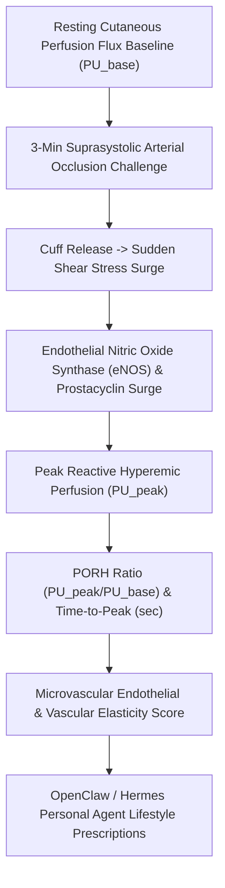

# Cutaneous Microvascular Reactive Hyperemia (PORH) Skill

[](LICENSE)
[](https://www.python.org/)
[](requirements.txt)
[](mcp_server.py)
[](SKILL.md)

Zero-dependency sovereign personal agent skill for non-invasive evaluation of Cutaneous Post-Occlusive Reactive Hyperemia (PORH), Laser Doppler flowmetry, time-to-peak, and endothelial nitric oxide reserve.



## Features
- **Deterministic Math**: Pure Python standard library implementation with zero external dependencies.
- **Vascular Physiology Standards**: Implements validated equations for Laser Doppler flux, hyperemic amplification ratio, and time-to-peak kinetics.
- **Microvascular Endothelial Dysfunction Detection**: Early sensitive screening for subclinical vascular stiffening and endothelial decay.
- **Model Context Protocol (MCP)**: Native JSON-RPC tool integration for LLMs and autonomous agents.

## Quickstart

```python
from client import CutaneousMicrovascularPORHClient

client = CutaneousMicrovascularPORHClient()
result = client.evaluate_porh(
    baseline_flux_pu=14.2,
    peak_hyperemic_flux_pu=72.5,
    time_to_peak_sec=7.2,
    recovery_time_sec=78.0
)
print("PORH Ratio:", result["porh_amplification_ratio"], "x")
print("Endothelial Score:", result["microvascular_endothelial_score"])
print("Classification:", result["classification"])
```

## License
Apache-2.0
